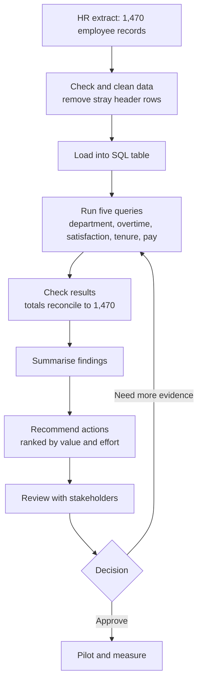

# Business Analysis Case Study: Employee Attrition

*A business analysis exercise built on my SQL project, [Employee Attrition Analysis](SQL_Portfolio_Project_HR_Attrition.md). It uses the public IBM HR Analytics sample dataset (1,470 employee records). The company, stakeholders and requirements are hypothetical. This is not client work.*

---

## 1. Business context

An HR leadership team is concerned about employee turnover. They can see people leaving, but they cannot say where it is concentrated, which factors are linked to it, or what to do first with a limited retention budget.

**Business problem:** HR has no evidence-based view of where attrition risk sits, so retention effort is spread thinly or aimed in the wrong places.

**Objectives**
1. Show where attrition is concentrated across departments and job roles.
2. Identify which measurable factors are most strongly associated with people leaving.
3. Recommend actions HR can start on, ranked by likely value and effort.

**In scope:** descriptive analysis of one employee snapshot (department, role, pay, satisfaction, overtime, tenure, attrition status).
**Out of scope:** predictive modelling, exit-interview analysis, individual-level risk scoring, and cost-of-attrition calculation.

---

## 2. Stakeholders

| Stakeholder | Interest | What they need |
|---|---|---|
| HR Director (sponsor) | Reduce turnover within budget | A short ranked list of actions and the evidence behind each |
| Heads of Sales and HR | Their teams show the highest attrition | Department-level figures they can check against their own view |
| Line managers | Day-to-day workload and team stability | Clear, practical signals, not statistics |
| Workforce planning / Finance | Headcount and hiring cost | Where replacement hiring is likely to concentrate |
| HR data owner | Data accuracy and privacy | Confidence that figures are reproducible and no individual is identifiable |

---

## 3. Requirements

### Business requirements
- **BR1.** HR must be able to see attrition rate by department.
- **BR2.** HR must be able to see which employee conditions (overtime, job satisfaction, tenure) are linked to higher attrition.
- **BR3.** HR must receive a short set of recommended actions with the evidence for each.

### User stories and acceptance criteria

**US1. Attrition by department**
As the HR Director, I want attrition rate by department so that I know where to focus first.
*Acceptance criteria:*
- Rate is shown as a percentage of department headcount, not a raw count.
- Total employees and number who left are shown next to each rate.
- Departments are ordered highest to lowest rate.

**US2. Overtime and attrition**
As a line manager, I want to see whether overtime is linked to people leaving so that I can review workload.
*Acceptance criteria:*
- Attrition rate is shown separately for employees who work overtime and those who do not.
- Group sizes are shown so the comparison can be judged fairly.

**US3. Job satisfaction and attrition**
As the HR Director, I want attrition by job satisfaction level so that I can decide whether a satisfaction pulse survey is worth running.
*Acceptance criteria:*
- All four satisfaction levels are shown in order.
- The trend (rising or falling) is stated in one sentence.

**US4. Tenure**
As workforce planning, I want average tenure of leavers compared with stayers so that I can see when people tend to leave.
*Acceptance criteria:*
- Average years at company is shown for both groups, to one decimal place.

**US5. Pay by role**
As the HR Director, I want average pay by department and role so that pay can be reviewed alongside attrition.
*Acceptance criteria:*
- Average monthly income is shown by department and job role with headcount.

**US6. Reproducibility**
As the HR data owner, I want every figure to come from a documented query so that results can be checked and repeated.
*Acceptance criteria:*
- Each finding links to the SQL that produced it.
- No individual employee can be identified from any output.

---

## 4. Process flow

---

## 5. Findings and traceability

| Requirement | Finding | Source |
|---|---|---|
| US1 / BR1 | Sales (20.6%) and HR (19.0%) have higher attrition than R&D (13.8%), although R&D is the largest department at 961 employees. Attrition is concentrated in specific functions. | Query 1 |
| US2 / BR2 | Employees who work overtime leave at 30.5%, against 10.4% for those who do not, nearly three times the rate. It is the strongest relationship in the data. | Query 2 |
| US3 / BR2 | Attrition falls as satisfaction rises, from 22.8% at the lowest level to 11.3% at the highest. | Query 4 |
| US4 / BR2 | Leavers averaged 5.1 years at the company; stayers 7.4. The gap is moderate, not an early-exit cliff. | Query 5 |
| US5 | Pay varies steeply by seniority within a department. In R&D, managers average 17,130 and laboratory technicians 3,237. | Query 3 |

---

## 6. Recommendations

| Priority | Recommendation | Why | Effort |
|---|---|---|---|
| 1 | Review overtime levels and policy, starting in Sales and HR | Strongest signal, and managers can act on it directly | Low to medium |
| 2 | Run a short job satisfaction pulse survey for low-scoring groups | Attrition roughly doubles at the lowest satisfaction level | Low |
| 3 | Look more closely at Sales and HR retention (exit reasons, manager feedback) | Both departments sit above the rest | Medium |
| 4 | Compare pay with attrition by role before drawing conclusions | Pay gaps are large, but this analysis does not show they cause leaving | Medium |

---

## 7. Assumptions, data quality and risks

**Data quality**
- The extract loaded with stray header rows inside the data. The queries filter these out. Group totals should add up to the 1,470 records in the dataset, which is worth confirming before results are shared.
- Income has no stated currency or period beyond "monthly", so pay figures are only used for comparison within the dataset.

**Assumptions**
- The dataset is a single snapshot, so it shows association at one point in time, not change over time.
- "Attrition = Yes" means the employee left, and no reason is recorded.

**Risks and limits**
- **Association is not cause.** Overtime may be linked to leaving because of workload, or because certain roles require more of it. This analysis cannot separate the two.
- **No exit reasons.** Without them, recommendations 3 and 4 need more evidence before action.
- **Sample data.** The conclusions apply to this dataset and are used here as a business analysis exercise.

---

## 8. Open questions for stakeholders
1. What is the current overall attrition rate target, and over what period?
2. Is overtime paid, voluntary or expected in Sales and HR?
3. Do HR hold exit-interview data that could explain the departmental differences?
4. What budget and owner exist for a pilot, if one is approved?
